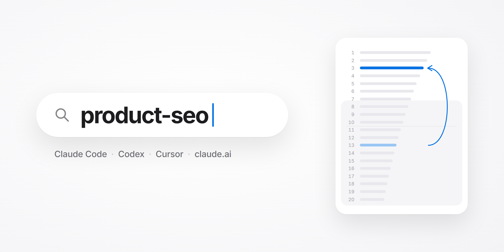
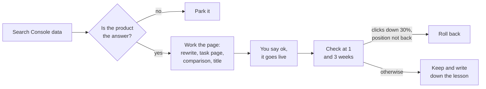

<p align="center"></p>

**English** · [Русский](README.ru.md)

An SEO skill for Claude Code, Codex and other coding agents. It grows signups from search for a product website, working from your own Search Console data.

## What it is

One skill that runs SEO for a site that sells a product. It starts from what people already find you for, sorts those topics by whether your product is the answer, and works on the ones where it is: pages, tools, cleanup, titles, mentions on other sites, AI search. Every change gets a date to be checked and a rule for undoing it.

It was built while growing HypeScribe. From August to early November 2026 the site got about 1M impressions and 9K clicks in Google, click-through rate went from 0.4% in spring to 0.9%, and clicks were almost double the three months before. That is what happened on one site. It is not a promise for yours.

## How it works



## Install

**Any agent**

```
npx skills add tipsai/product-seo
```

The installer asks which agents to set it up for.

Or just tell your agent: `Install the product-seo skill from https://github.com/tipsai/product-seo`

**Claude Code, as a plugin**

```
/plugin marketplace add tipsai/product-seo
/plugin install product-seo@tipsai
```

**Codex, as a plugin**

```
codex plugin marketplace add tipsai/product-seo
codex plugin add product-seo@tipsai
```

Restart Codex, then just describe the SEO task, or call the skill with `$product-seo`.

**Cursor, or any agent by hand**

Copy the folder `skills/product-seo` to `~/.cursor/skills/product-seo` (Cursor) or `~/.agents/skills/product-seo` (Codex and other agents that read that folder).

**claude.ai**

Download `product-seo.zip` from the [latest release](https://github.com/tipsai/product-seo/releases/latest). In claude.ai open Customize, Skills, press "+", and upload the ZIP. Code execution must be turned on.

## First run

Open your project and say:

> Set up SEO for my site.

The agent asks a few questions (what the product does, who pays, what must never be claimed, how pages get published), creates a `seo/` folder for its notes, and asks for a Search Console export (in Search Console: Performance, last 3 months, Export, CSV). Then it shows you two lists: topics where your product is the answer, and topics that only bring readers. It proposes the first three things to do.

After that, ask for what you need:

- "Which pages are closest to the first page of Google?"
- "Check our old articles: what is broken or out of date?"
- "What should we write about next?"
- "Rewrite this page"
- "Our titles get few clicks, fix the worst five"
- "We have three articles on the same thing, what do we do?"
- "Make a page for people who search for <task>"
- "Write a comparison with <competitor>"
- "Where can we get listed?"
- "The rewrite went live three weeks ago. Did it work?"

<details>
<summary><b>What the first answer looks like</b> (an invented site, not real data)</summary>

> **Verdict:** two pages are worth your time first, and one query has two of your pages fighting each other. Data: Search Console, 1 Sep to 26 Oct.
>
> - **"meeting notes template"**: 3,360 impressions, position 11.5, so page two. Your product makes meeting notes, so this is the "product is the answer" pile. Rewrite this page first.
> - The same query also shows `/blog/notes-template-free` at position 13. Two pages split the demand. Merge the weaker one into the stronger with a 301, after checking which ranks higher on the shared queries.
> - **"voice memo to text"**: 1,680 impressions at position 16, and no page is built for it. The results for it are tools, so a page where people convert a memo on the spot fits better than an article.
> - Brand searches give 75% of clicks. Everything above excludes them.
>
> **Next:** confirm the two piles, and I start with the rewrite.

</details>

**The site is new and not in Search Console yet?** Say so. The agent helps connect Search Console and Bing, checks that the site can be indexed and that signups are measured, finds demand with free tools, and plans the first three to five pages. After one to three months of data it switches to the usual triage.

## What it does

| Play | What happens |
|---|---|
| Triage | Your queries are split into "the product is the answer" and "traffic only". You get an ordered list for the first pile, starting with pages at positions 8–20. |
| Ideas | What to write next: where ideas come from, which page types fit a product site, and which topics bring readers who never sign up. |
| Audit live pages | Old pages checked one by one: how the text sounds, how it looks on a phone, stale facts and prices, junk links, whether the calls to try the product work. You get a table of problems by severity and approve the fixes. |
| Rewrite a page | Queries, facts, a draft in a form that fits the reader's task, images, review by a second model, a reader check on screenshots. You approve before anything goes live. |
| A real author | Every article signed by a real person: photo, role, a link to their profile, dates, and matching structured data. Google encourages accurate bylines. We did it across the blog and kept it. |
| Titles and descriptions | For pages that rank on page one and get few clicks. |
| Cleanup | Thin and duplicate pages are removed or merged with 301 redirects, with checks that prevent the usual damage. |
| Task pages and free tools | A page for one exact query where the visitor does the job right there, and small tools linked from the footer and from articles. |
| Comparison pages | "X vs Y" and "alternatives" that say plainly where you are stronger and where the competitor is. In our experience honest pages bring more customers, and AI assistants are more willing to quote them. |
| Links and listings | A list of places to get listed, every application text drafted for you, and messages to authors of roundups. You send them. |
| AI search | Crawler access, `llms.txt` with its real status, and what makes a product show up in assistants' answers. |
| Measure and roll back | Checks at one and three weeks. If clicks fell by 30% or more and the position is not returning, the old version comes back. |

## How the agent keeps its notes

A session ends and its memory goes with it. So the skill writes everything into a `seo/` folder in your project, and adds a few lines to your `CLAUDE.md` or `AGENTS.md` so that every new session reads those notes first.

```
seo/
  site-profile.md    your product, who pays, which topics matter, your standing decisions
  change-log.md      every change, its backup, when it will be checked, what the check showed
  lessons.md         what to do differently next time
  product-facts.md   the only source for anything written about your product
  sources/           facts about competitors: quote, link, date
  backups/           old versions of changed pages
```

At the start of each session the agent tells you which checks are due. It also looks at what changed in your product since last time (your changelog, task tracker or repository, or it simply asks you), updates the facts file, and lists live pages that still carry an old price or a removed feature. It can read signups from whatever analytics you already have.

## Why it works this way

Each rule in the skill comes from three months of doing this on a live site.

**Most clicks usually come from topics that never sign up.** It is easy to spend months improving pages that bring readers. Sort topics by signups, and the ones that bring customers often turn out to sit on the second page of results. So the first step is always the two piles.

**Fewer, better pages.** One page that answers a query better than the current top ten beats ten pages that repeat them. Over these months we removed or merged more weak pages than we published new ones.

**The model invents competitors' features.** Asked to compare products, it fills gaps with what sounds right. Now a separate agent collects facts only from official pages, with the quote, the link and the date, and the writer may use nothing else. Two weeks later those facts are checked again, because by then they have changed.

**A rewrite dips before it grows.** One batch of rewritten pages fell for weeks and then ended far above where it started. Had we judged it after one week we would have undone a gain. The decision is made at three weeks, by a rule written down in advance.

**Identical pages look generated.** When every article follows one skeleton and every cover one layout, a blog read in a row looks machine-made. So each page gets its own form and each cover its own format. Google does not punish a shared layout as such; it filters pages that repeat each other and pages made in bulk to rank. One skeleton for everything is how you end up writing the same page twice.

**Listings are easy to lose track of.** A list of places is useless if nobody records where the product was actually submitted. Listings matter for being known to Google and to AI assistants, even when they send no visitors, so the skill keeps a checklist with a status for every place.

## What you need

To start: a CSV export from Google Search Console. Nothing else.

Useful later, all optional:

| For | Free | Paid |
|---|---|---|
| Full query data | Search Console API with a service account | |
| A second search engine | Bing Webmaster Tools | |
| Search volumes for new topics | Google Keyword Planner, Google Trends | A pay-as-you-go keyword API, or a subscription suite if you already have one |
| Who links to you | Search Console, Ahrefs Webmaster Tools for your own site | The same paid tools |
| Signups by page | Whatever analytics you already use | |
| Screenshots | Playwright | |

The skill's setup guide has the options by budget with prices and the date they were checked. Nothing paid is required, and no particular vendor is assumed.

The helper scripts need Node.js 18 or newer and no packages. Without Node the agent works from your exports.

## Works well with

- [humanizer](https://github.com/blader/humanizer): removes machine-writing patterns from page drafts before the review pass. A separate skill by another author; product-seo works without it.

## What it will not do

- Publish, redirect or delete anything without your "ok".
- Submit forms or send emails. It drafts, you send.
- Give your site a score out of 100.
- Generate pages in bulk.
- Promise positions.

## What is in the repository

```
skills/product-seo/
  SKILL.md        the rules and the map of plays
  references/     one file per play, each ending with common mistakes
  assets/         templates, prompts for helper agents, the list of directories
  scripts/        seven small Node.js scripts
docs/ru/          the method in Russian, for reading
```

The list of directories is for an English-language AI product. For another market the skill builds a local list by the same method.

## License

MIT. Made by Igor Trunin, [@tips_ai](https://t.me/tips_ai) on Telegram.
