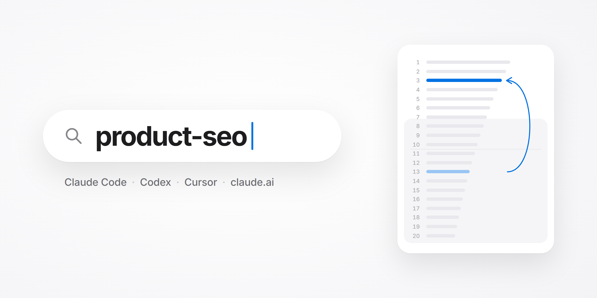
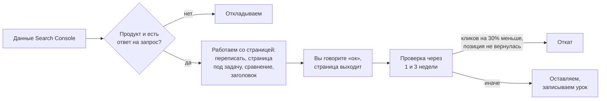

<p align="center"></p>

[English](README.md) · **Русский**

SEO-скилл для Claude Code, Codex и других агентов. Помогает получать из поиска регистрации, а не просто показы. Работает по вашим данным из Search Console.

## Что это

Один скилл, который ведёт SEO сайта с продуктом. Он смотрит, по каким запросам вас уже находят, делит темы на «продукт и есть ответ» и «просто читают», и работает с первыми: страницы, мини-тулы, чистка, заголовки, упоминания на других сайтах, ИИ-поиск. У каждой правки есть дата проверки и правило, когда её откатывать.

Скилл вырос из работы над HypeScribe. С августа по начало ноября 2026 сайт получил около 1 млн показов и 9 тыс. кликов в Google, CTR вырос с 0,4% весной до 0,9%, а кликов стало почти вдвое больше, чем за три месяца до этого. Так вышло на одном сайте. Вам этого никто не обещает.

## Как он работает



## Установка

**Любой агент**

```
npx skills add tipsai/product-seo
```

Установщик спросит, для каких агентов ставить.

Или просто напишите агенту: `Установи скилл product-seo из https://github.com/tipsai/product-seo`

**Claude Code, плагином**

```
/plugin marketplace add tipsai/product-seo
/plugin install product-seo@tipsai
```

**Codex, плагином**

```
codex plugin marketplace add tipsai/product-seo
codex plugin add product-seo@tipsai
```

Перезапустите Codex и просто опишите задачу по SEO или вызовите скилл через `$product-seo`.

**Cursor или любой агент, руками**

Скопируйте папку `skills/product-seo` в `~/.cursor/skills/product-seo` (Cursor) или в `~/.agents/skills/product-seo` (Codex и другие агенты, которые читают эту папку).

**claude.ai**

Скачайте `product-seo.zip` из [последнего релиза](https://github.com/tipsai/product-seo/releases/latest). В claude.ai откройте Customize, Skills, нажмите «+» и загрузите архив. Выполнение кода должно быть включено.

## Первый запуск

Откройте проект и напишите:

> Настрой SEO для моего сайта.

Агент задаст несколько вопросов: что делает продукт, кто за него платит, чего о нём нельзя писать, как публикуются страницы. Потом заведёт папку `seo/` для своих заметок и попросит выгрузку из Search Console (в Search Console: «Эффективность», последние 3 месяца, «Экспорт», CSV). В ответ покажет два списка: темы, где ваш продукт и есть ответ, и темы, которые только приводят читателей. И предложит, с каких трёх дел начать.

Дальше просите, что нужно:

- «Какие страницы ближе всего к первой странице Google?»
- «Проверь наши старые статьи: что сломано или устарело?»
- «О чём нам написать дальше?»
- «Перепиши эту страницу»
- «По нашим заголовкам мало кликают, поправь пять худших»
- «У нас три статьи про одно и то же, что делать?»
- «Сделай страницу для тех, кто ищет <задача>»
- «Напиши сравнение с <конкурент>»
- «Куда нам добавиться?»
- «Три недели назад выкатили новую версию. Сработало?»

<details>
<summary><b>Как выглядит первый ответ</b> (выдуманный сайт, не настоящие данные)</summary>

> **Вывод:** сначала стоит заняться двумя страницами, и по одному запросу ваши страницы мешают друг другу. Данные: Search Console, 1 сентября – 26 октября.
>
> - **«meeting notes template»**: 3 360 показов, позиция 11,5, то есть вторая страница. Ваш продукт делает заметки по встречам, значит, это куча «продукт и есть ответ». Эту страницу переписываем первой.
> - По тому же запросу показывается и `/blog/notes-template-free` на 13-м месте. Две страницы делят спрос. Слабую склеиваем с сильной через 301, но сначала проверяем, какая из них выше по общим запросам.
> - **«voice memo to text»**: 1 680 показов на 16-м месте, и отдельной страницы под него нет. В выдаче по нему стоят сервисы, поэтому лучше сделать страницу, где человек сразу переводит запись в текст, а не статью.
> - 75% кликов дают запросы с названием бренда. Всё, что выше, посчитано без них.
>
> **Дальше:** подтвердите две кучи, и я начну с переписывания.

</details>

**Сайт новый и его ещё нет в Search Console?** Так и скажите. Агент поможет подключить Search Console и Bing, проверит, что сайт открыт для поисковиков и что регистрации считаются, найдёт спрос бесплатными инструментами и спланирует первые 3–5 страниц. Через 1–3 месяца, когда появятся данные, перейдёт к обычному разбору.

## Что он делает

| Работа | Что происходит |
|---|---|
| Разбор | Запросы делятся на две кучи: «продукт и есть ответ» и «просто трафик». По первой куче вы получаете список по порядку, начиная со страниц на 8–20 месте. |
| Идеи | О чём писать дальше: откуда брать темы, какие виды страниц подходят сайту с продуктом и какие темы приводят читателей, которые не регистрируются. |
| Проверка старых страниц | Смотрим уже опубликованное: как звучит текст, как страница выглядит на телефоне, устаревшие факты и цены, мусорные ссылки, работают ли призывы попробовать продукт. Вы получаете таблицу проблем по важности и утверждаете правки. |
| Переписать страницу | Запросы, факты, черновик в форме под задачу читателя, картинки, вычитка второй моделью, проверка глазами читателя по скриншотам. Без вашего «ок» ничего не публикуется. |
| Настоящий автор | У каждой статьи живой автор: фото, роль, ссылка на профиль, даты и такая же разметка для поисковиков. Google советует честно указывать авторство. Мы сделали это по всему блогу и оставили. |
| Заголовки и описания | Для страниц, которые уже на первой странице выдачи, но по ним мало кликают. |
| Чистка | Слабые страницы и дубли убираем или склеиваем через 301. С проверками, которые спасают от типичных ошибок. |
| Страницы под задачи и мини-тулы | Страница ровно под один запрос, где человек сразу делает дело. И небольшие тулы со ссылками из футера и статей. |
| Сравнения | «X против Y» и «альтернативы», где прямо сказано, в чём сильны вы, а в чём конкурент. По нашему опыту, честные страницы лучше приводят клиентов, а ИИ-ассистенты охотнее их цитируют. |
| Ссылки и каталоги | Список площадок, тексты заявок под каждую и письма авторам подборок. Отправляете вы. |
| ИИ-поиск | Доступ для роботов, `llms.txt` и его настоящий статус, что помогает попасть в ответы ассистентов. |
| Замер и откат | Проверки через неделю и через три. Если кликов стало меньше на 30% и больше, а позиция не возвращается, ставим старую версию обратно. |

## Как агент ведёт заметки

Сессия закончилась, и её память пропала. Поэтому скилл всё записывает в папку `seo/` в вашем проекте и добавляет несколько строк в ваш `CLAUDE.md` или `AGENTS.md`. Каждая новая сессия сначала читает эти заметки.

```
seo/
  site-profile.md    продукт, кто платит, какие темы важны, ваши постоянные решения
  change-log.md      каждая правка, её копия, когда проверяем и что показала проверка
  lessons.md         что в следующий раз сделать иначе
  product-facts.md   единственный источник для всего, что пишется о продукте
  sources/           факты о конкурентах: цитата, ссылка, дата
  backups/           старые версии изменённых страниц
```

В начале каждой сессии агент говорит, какие проверки подошли. Ещё он смотрит, что изменилось в продукте с прошлого раза: в списке изменений, в трекере задач, в репозитории, или просто спрашивает вас. Потом обновляет файл фактов и показывает страницы, где осталась старая цена или убранная функция. Регистрации он может читать из той аналитики, которая у вас уже стоит.

## Почему именно так

Каждое правило в скилле взято из трёх месяцев такой работы на живом сайте.

**Большинство кликов обычно идёт по темам, с которых никто не регистрируется.** Можно месяцами улучшать страницы, которые приводят читателей. Стоит разложить темы по регистрациям, и часто оказывается, что темы с клиентами стоят на второй странице выдачи. Поэтому первым делом всегда две кучи.

**Лучше меньше страниц, но сильных.** Одна страница, которая отвечает на запрос лучше нынешней первой десятки, полезнее десяти, которые её повторяют. За эти месяцы мы убрали и склеили больше слабых страниц, чем опубликовали новых.

**Модель придумывает конкурентам функции.** Просишь сравнить продукты, и она заполняет пробелы тем, что звучит правдоподобно. Теперь факты собирает отдельный агент, только с официальных страниц, с цитатой, ссылкой и датой. Автору нельзя писать ничего сверх этого. Через две недели факты проверяем заново: к этому времени они уже поменялись.

**После переписывания страница сначала проседает.** Одна пачка переписанных страниц несколько недель падала, а потом встала намного выше, чем была. Если бы мы судили по первой неделе, откатили бы рост. Поэтому решение принимаем через три недели и по правилу, которое записано заранее.

**Одинаковые страницы выглядят сгенерированными.** Если все статьи на один скелет, а обложки на один макет, блог подряд читается как сделанный машиной. Поэтому у каждой страницы своя форма, у каждой обложки свой формат. Сам по себе одинаковый макет Google не наказывает. Он отсеивает страницы, которые повторяют друг друга, и страницы, сделанные пачкой ради позиций. Один скелет на всё как раз приводит к тому, что пишешь одну и ту же страницу дважды.

**В заявках легко запутаться.** Список площадок бесполезен, если не записывать, куда продукт на самом деле подан. Каталоги нужны, чтобы о продукте знали Google и ИИ-ассистенты, даже если оттуда никто не приходит. Поэтому скилл ведёт список с отметкой по каждой площадке.

## Что нужно

Чтобы начать: выгрузка CSV из Google Search Console. Больше ничего.

Пригодится потом, всё по желанию:

| Зачем | Бесплатно | Платно |
|---|---|---|
| Полные данные по запросам | API Search Console с сервисным аккаунтом | |
| Второй поисковик | Bing Webmaster Tools, Яндекс Вебмастер | |
| Спрос по новым темам | Планировщик ключевых слов Google, Google Trends | API с оплатой за запрос или подписка, если она у вас уже есть |
| Спрос в Яндексе | Сайт Вордстата | API Вордстата в Yandex Cloud, за запросы |
| Кто на вас ссылается | Search Console, Ahrefs Webmaster Tools для своего сайта | Те же платные сервисы |
| Регистрации по страницам | Аналитика, которая у вас уже стоит | |
| Скриншоты | Playwright | |

В инструкции по настройке внутри скилла есть варианты под разный бюджет, с ценами и датой проверки. Платное не обязательно, и ни к одному сервису скилл не привязан.

Скриптам нужен Node.js 18 или новее, пакеты ставить не надо. Без Node агент работает по вашим выгрузкам.

## Хорошо работает вместе с

- [humanizer](https://github.com/blader/humanizer): убирает из черновиков страниц типичные признаки ИИ-текста до вычитки. Это отдельный скилл другого автора, product-seo работает и без него.

## Чего он не делает

- Не публикует, не ставит редиректы и не удаляет без вашего «ок».
- Не отправляет заявки и письма. Он готовит, отправляете вы.
- Не ставит сайту оценку из 100.
- Не штампует страницы пачками.
- Не обещает позиции.

## Что лежит в репозитории

```
skills/product-seo/
  SKILL.md        правила и карта работ
  references/     по файлу на каждую работу, в конце каждого частые ошибки
  assets/         шаблоны, задания для помощников, список каталогов
  scripts/        семь небольших скриптов на Node.js
docs/ru/          весь метод по-русски, для чтения
```

Сам скилл написан по-английски: так агенты понимают его точнее. Отвечать он будет на вашем языке. Весь метод по-русски лежит в [docs/ru/playbook.md](docs/ru/playbook.md).

Список каталогов собран под англоязычный ИИ-продукт. Для другого рынка скилл соберёт свой список тем же способом. Для русскоязычного продукта у нас лучше всего сработали свои статьи на vc.ru. Это наш опыт с одним продуктом, а не правило.

## Лицензия

MIT. Сделал Игорь Трунин, канал [@tips_ai](https://t.me/tips_ai) в Telegram.
